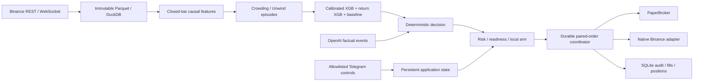

# Architecture

The installed package and executable are both `paperfrog`. All trading arithmetic at the exchange boundary uses Decimal; statistical research uses NumPy/pandas. The engine is asyncio based, with one execution owner per state directory and SQLite WAL transactions for durable intent and reservation records.

`domain` holds typed order/filter/quote contracts; `exchange` isolates signing, transport, verified endpoints and streamed observations. `execution` writes intent before submission and resolves unknown states through the existing ID. `paper` implements the same broker protocol. `risk` owns account anchors and reservation invariants. `strategy` only creates candidates and exit decisions. `llm` has no execution dependency or order tool. `telegram` receives narrowly scoped control callbacks.

`data`, `features`, `models`, and `backtest` form the research path. Artifacts carry schema and content hashes. Promotion is local and explicit. `reporting` refuses missing readiness evidence. `service` runs monitoring, research refresh, signal evaluation, held-event checks, Telegram and loopback health concurrently; stopping entries does not stop exits.

## Persistence

Tables: `kv` (versioned snapshots), `audit` (append-oriented events), `events` (deduplication), `entries` (atomic strategy reservations), `orders` (intent/status/result), and `fills` (unique terminal exchange summaries). Configuration versions, universe inputs/reasons, episodes, predictions, events, risk anchors, approvals and state transitions are stored as structured JSON snapshots/audits. Reservations consume the daily cap even when execution aborts, a conservative overcount. Raw orders and strategy trades have separate counts.

SQLite is a single-host design. The local operator and host filesystem are trusted; this is not a multi-tenant order service. No remote configuration mutation API exists. Reports require operator review; editing their JSON is not evidence of passing research gates.

## States

| State | New entries | Exits/monitoring/reconciliation | Resume |
|---|---|---|---|
| BOOTING / SYNCING | No | Reconciliation first; reductions allowed once account known | Complete startup |
| READY_PAPER / READY_TESTNET / READY_LIVE_DISARMED | No | Continue | Health, model and applicable local arm |
| RUNNING | All entry gates required | Continue | Already running |
| PAUSED | No | Continue | Explicit resume and fresh health |
| DEGRADED / ERROR_SAFE | No | Continue; reconcile unknown state | Resolve cause, explicit resume |
| SOFT_RISK_LOCK | No | Continue | Expiry or manual pause release with health |
| DAILY_RISK_LOCK | No | Flatten on breach | Next UTC day and health |
| WEEKLY_RISK_LOCK | No | Flatten on breach | Local review; anchors retained |
| HARD_RISK_LOCK | No | Emergency reduction | Local review; anchors retained |
| EMERGENCY_FLATTENING | No | Cancel entries, reduce, verify | Remain manually locked |

The service deliberately starts PAUSED after synchronization, including a clean restart. READY values are domain states available to clients; startup does not automatically advance through them into RUNNING. Resume does not weaken a stored risk lock. Time-based locks require health and operator resume in this conservative release.
